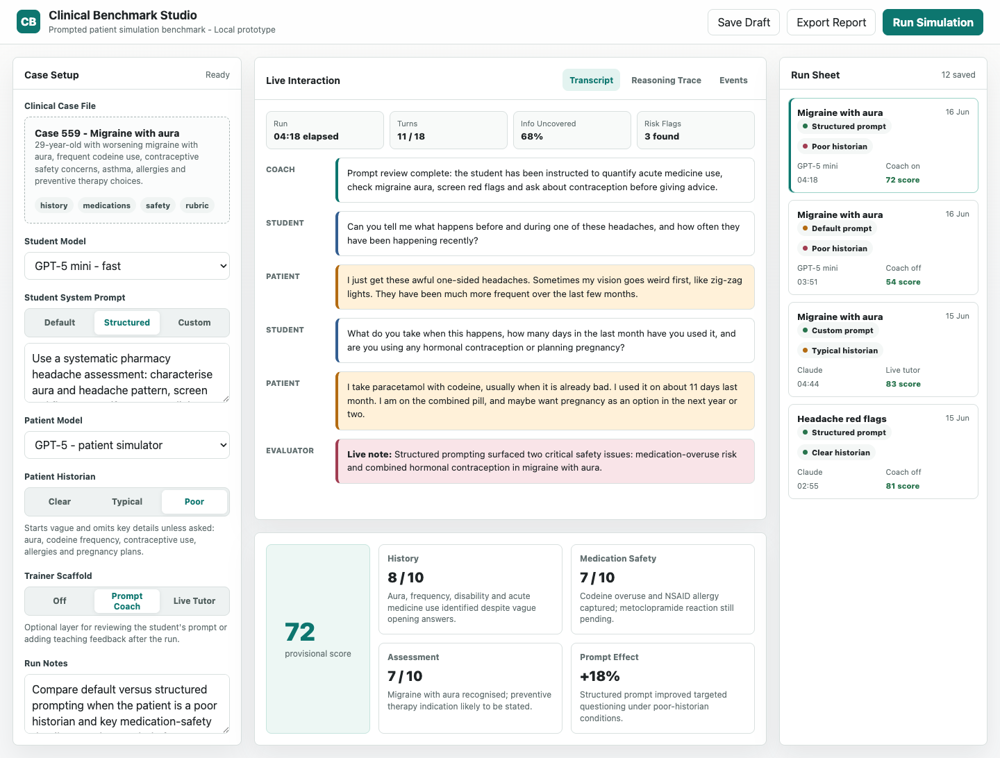

# Clinical Benchmark Studio — Assigned-Task Scoring v2



The primary score answers: **did the model perform the behaviour it was assigned?** An angry role is rewarded for being credibly angry, a reluctant role for being reluctant, and a supportive role for being supportive. Calmness, cooperation, disclosure and clinical completeness are not treated as universally desirable.

## Install

Requires Python 3.9+.

```bash
python3 -m venv .venv
source .venv/bin/activate
pip install -r requirements.txt
```

## Run

Provide your OpenAI API key as an environment variable (or copy `.env.example` to `.env` and fill it in — `.env` is gitignored and must never be committed):

```bash
export OPENAI_API_KEY="your_key_here"
python3 app.py
```

Then open:

```text
http://127.0.0.1:8765/
```

## Current Scope

### Scoring v2.1

- Converts Prompt A into a frozen, structured assigned-behaviour contract before scoring.
- Uses a deterministic weighted Assigned-Task score:
  - Assigned Task Fidelity: 50%
  - Conversational Realism: 20%
  - Information Behaviour: 20%
  - Case Fidelity: 10%
- Scores healthcare-professional clinical performance separately against the case rubric, so it cannot cancel behavioural fidelity.
- Applies a 49/100 clinical-score cap when the evaluator identifies a critical safety error.
- Gives custom patient/counterpart simulations the complete private factual record while retaining the prompt's control over recall and disclosure.
- Uses temperature `0.7` for simulations, `0` for evaluation/contract extraction, and `0.3` for prompt improvement by default.
- Rescores Prompt A and Prompt B together under anonymous X/Y labels; the final judge does not see the earlier scorecard.
- Uses unanchored `null` placeholders in evaluator JSON schemas so example numbers cannot be copied as scores.
- Requires pairwise score differences to agree with stated transcript-level advantages unless an offsetting weakness is identified.
- Excludes raw patient dialogue and case-fidelity commentary from patient-prompt improvement inputs.
- Validates improved prompts for length, portable paragraph format, role preservation, private case terms, case-like exact numbers and embedded dialogue examples; failed candidates receive up to three constrained repairs.
- Replicated batch runs generate one candidate per level, retest the same candidate, calculate a mean paired delta and 95% interval, and load a candidate only when the interval is positive with no critical safety regression.
- Treats malformed evaluator output as an invalid/missing score instead of a numerical zero.

Temperatures can be adjusted without editing code:

```bash
export SIMULATION_TEMPERATURE="0.7"
export EVALUATOR_TEMPERATURE="0"
export IMPROVER_TEMPERATURE="0.3"
python3 app.py
```

### Verification

Run the local non-API tests with:

```bash
python3 -m unittest -v test_scoring_v2.py
```

- Supports `gpt-5.4-nano`, `gpt-5.4-mini`, and `gpt-4o-mini` in the model selectors.
- Includes a separate case-library home page with migraine, asthma, dyspepsia/NSAID-risk and UTI-in-pregnancy cases.
- Supports selecting a case from the home page or case setup panel.
- Includes target modes for tuning either the clinician simulator prompt or the patient simulator prompt.
- Supports uploading a compatible JSON case for local prototype runs.
- Supports clinician prompt mode and patient historian style.
- Poor/typical/clear historian behavior is grounded in recall, specificity and whether the student asks the patient to check packets, diaries, letters or lists.
- Patient prompt testing sends the user's patient prompt as the patient system prompt, with case memory supplied separately as visible private memory.
- Exposes the clinical case file as a downloadable JSON file from the case setup panel.
- Runs normal practice conversations as background jobs through `/api/run-job`; the frontend polls until the transcript and scorecard are ready.
- Includes `/api/prompt-preview` and a Prompt Preview panel showing the clinician, patient and evaluator messages built for the current run.
- Supports restarting the case from the UI.
- Allows up to 30 clinician-patient exchanges for both clinician and patient prompt tests, with a 10-exchange minimum before early finalisation.
- Detects final answers written as `FINAL:` or markdown-style `## FINAL:` and prevents them being sent back to the patient.
- Produces an assigned-task scorecard, separate clinical score where applicable, and adds the run to the run sheet.
- Can generate an improved custom clinician or patient prompt from evaluator feedback, then rerun the same case for comparison.

## Notes

If the page shows an `OPENAI_API_KEY` error, restart `app.py` from a terminal where the key is exported.
